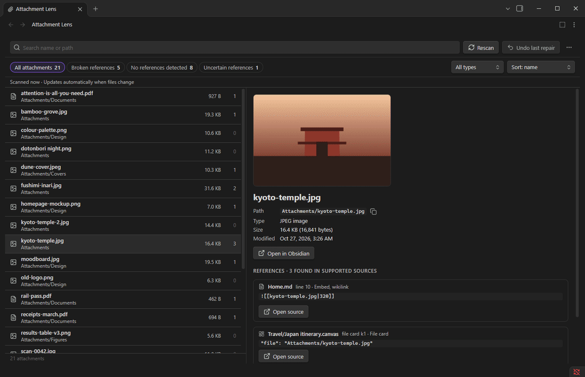
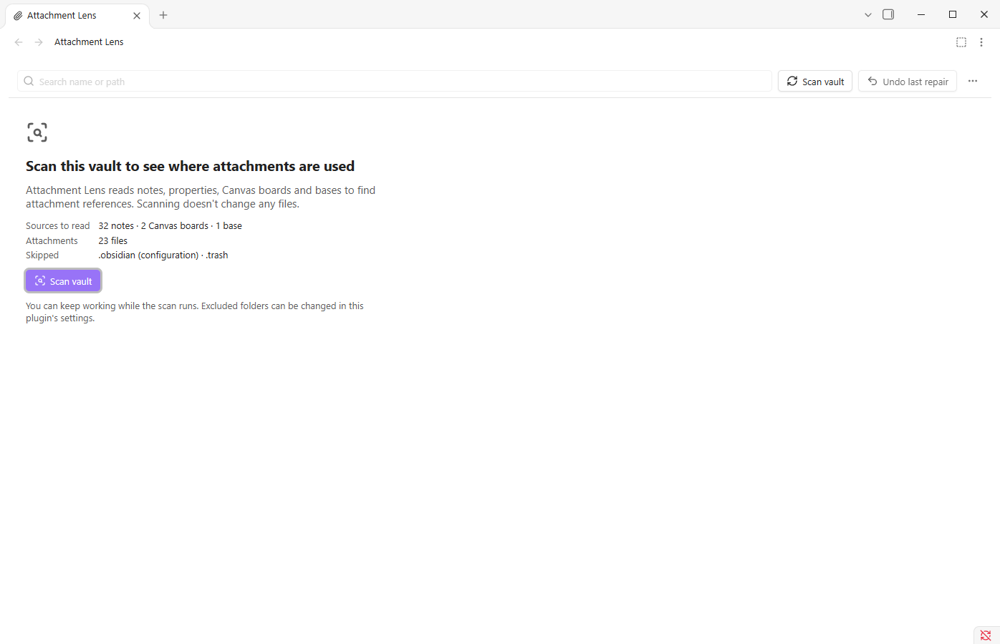
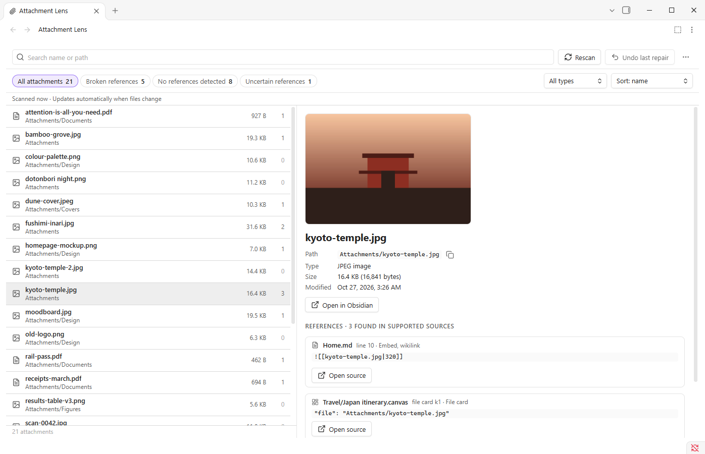
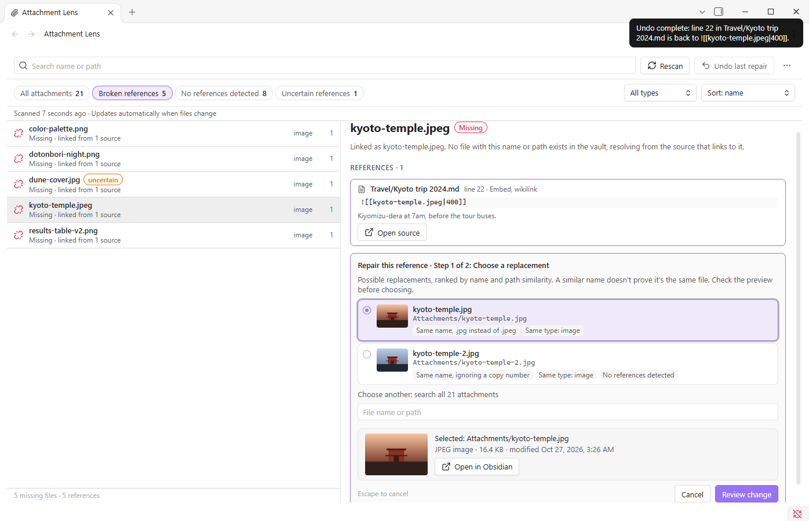
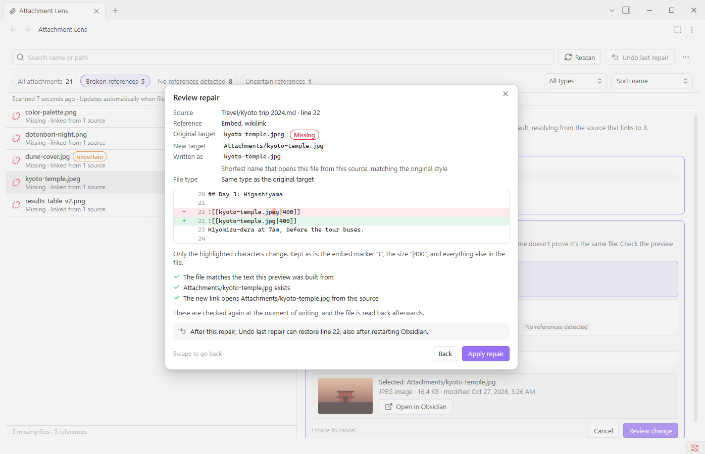
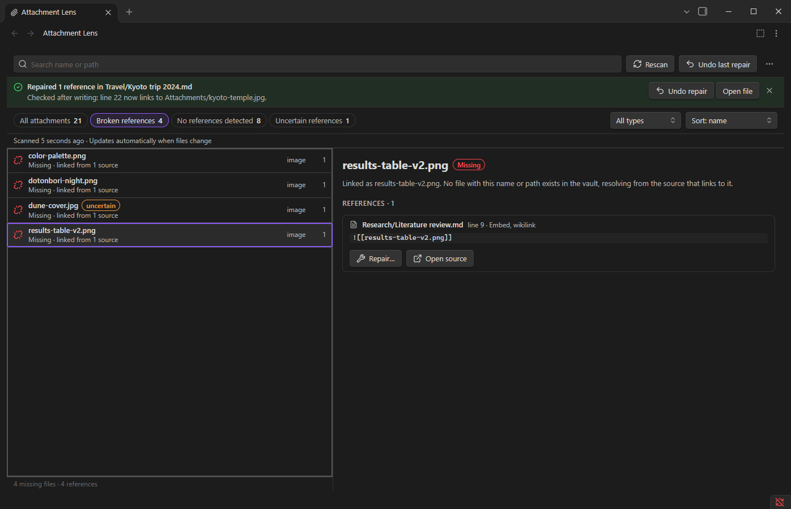
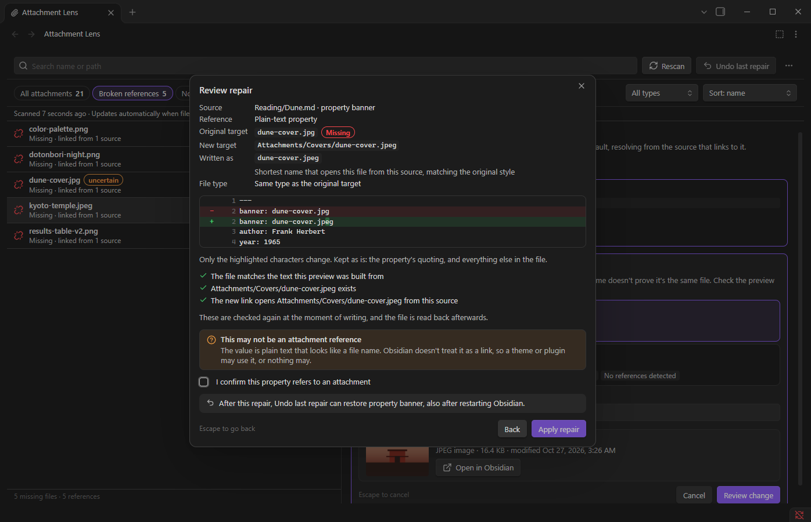
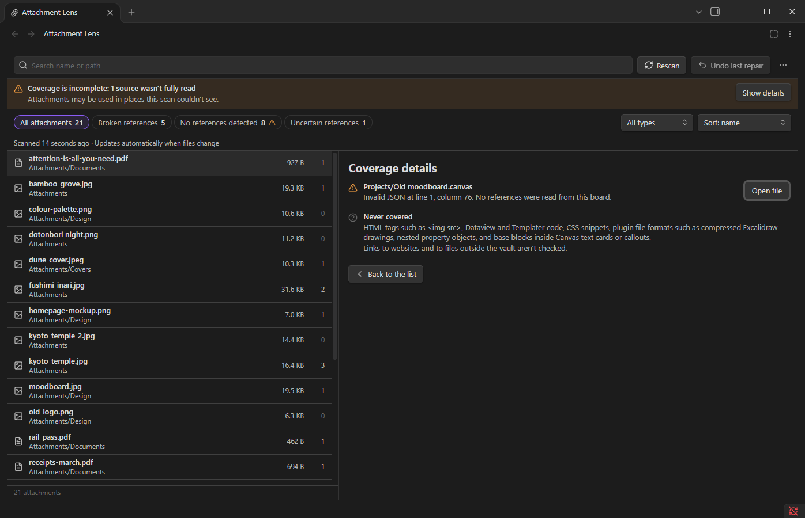
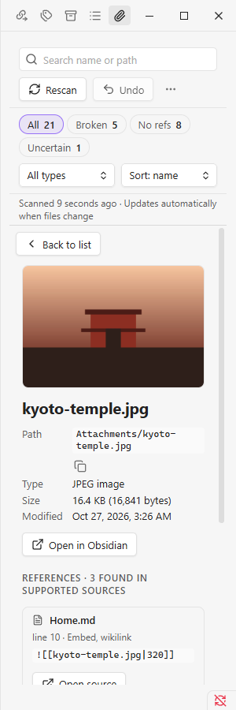
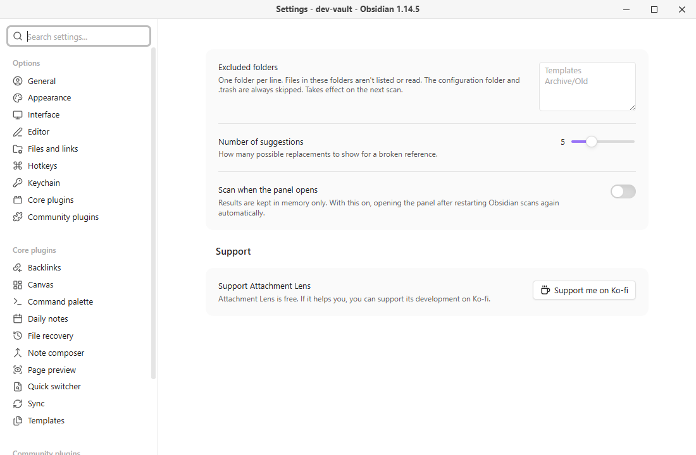

<h1 align="center">Attachment Lens</h1>

<p align="center">
  <b>See where every attachment in your vault is used. Find broken attachment links, and repair them safely, one at a time.</b>
</p>

<p align="center">
  <a href="https://github.com/jokeroct/attachment-lens/releases/latest"></a>
  
  <a href="LICENSE"></a>
</p>

<p align="center">
  
</p>

<p align="center">
  <a href="https://ko-fi.com/mdsama"></a>
</p>

<p align="center">
  <a href="#install">Install</a> ·
  <a href="#quick-start">Quick start</a> ·
  <a href="#guide">Guide</a> ·
  <a href="#what-gets-scanned">What gets scanned</a> ·
  <a href="#faq">FAQ</a> ·
  <a href="#support">Support</a>
</p>

---

## What it does

- **Shows every attachment** in one searchable list: images, PDFs, audio, video, documents, archives and any other file that isn't a note.
- **Shows where each one is used.** Notes, properties, Canvas boards and bases all count, and every reference shows its exact text and location.
- **Finds broken attachment links,** such as an image renamed outside Obsidian or a PDF moved to another folder.
- **Repairs them one at a time.** It suggests the file you probably meant, shows you the exact change, and only writes after you confirm. Every repair can be undone.

### Safe by design

| | |
| --- | --- |
| 🔍 **Scanning never changes files** | Attachment Lens only reads your vault until you choose **Apply repair**. |
| ✋ **Nothing happens automatically** | No replacement is ever chosen for you. You pick it, review it, then apply it. |
| 🎯 **One reference per repair** | A repair changes the characters of one link in one file. Everything else stays as it is, down to spacing and line endings. |
| 🛡️ **Checked before and after writing** | If the note changed since you looked at the preview, nothing is written. After writing, the file is read back to confirm the result. |
| ↩️ **Undo that survives a restart** | **Undo last repair** puts the original text back, also after you close Obsidian. It refuses if you've edited the file since, so newer work is never overwritten. |
| 📎 **Attachments are never touched** | No renaming, moving or deleting of attachment files, ever. |
| 🔒 **Private** | No network requests, no accounts, no telemetry. |

---

## Install

### From Obsidian

1. Open **Settings → Community plugins** and turn off **Restricted mode** if it's on.
2. Choose **Browse**, search for **Attachment Lens**, and choose **Install**.
3. Choose **Enable**.

Attachment Lens needs Obsidian **1.14 or newer** on Windows, macOS or Linux. A mobile version is planned.

### By hand

1. From the [latest release](https://github.com/jokeroct/attachment-lens/releases/latest), download `main.js`, `manifest.json` and `styles.css`.
2. In your vault, create the folder `.obsidian/plugins/attachment-lens/` (if you renamed Obsidian's configuration folder, use that instead of `.obsidian`).
3. Put the three files in it, then in **Settings → Community plugins** reload the list and turn on **Attachment Lens**.

---

## Quick start

### 1. Open the panel and scan

Click the **paperclip** in the left ribbon, or run **Attachment Lens: Open** from the command palette (Ctrl/Cmd+P). The panel opens as a tab. Choose **Scan vault**.



The scan reads your notes, properties, Canvas boards and bases. It runs in small steps, so you can keep working, and **Cancel scan** stops it at any time. After the first scan, the results follow your changes automatically.

### 2. Browse your attachments

<picture>
  <source media="(prefers-color-scheme: dark)" srcset="docs/images/overview-dark.png">
  
</picture>

| Part | What it's for |
| --- | --- |
| **Search** | Type part of a file name or folder. Ctrl/Cmd+F jumps here. |
| **Filters** | **All attachments**, **Broken references**, **No references detected** and **Uncertain references**, each with a live count. |
| **All types** and **Sort** | Show only images, PDFs, audio, video, documents or archives, and sort by name, folder, size, date or number of references. |
| **The list** | Every attachment with its folder, size and number of references. Click a row or use the arrow keys. |
| **Details** | A preview for images, the path (with a copy button), type, size and date, and every place the file is used. **Open source** takes you to the exact line. |

### 3. Fix a broken link

Choose **Broken references**. Each row is a file that's linked somewhere but doesn't exist. Select one, then choose **Repair…** on the reference you want to fix.



Pick the file you meant. Suggestions are ranked by how similar their names and folders are, and each one says why it's there, for example **Same name, .jpg instead of .jpeg**. If the right file isn't listed, search all attachments underneath. When you've chosen, select **Review change**.



The review dialog shows exactly what will change, highlighted in context. Nothing is written yet. Choose **Apply repair** to write it, or **Back** to choose another file.



The banner confirms the repair was checked after writing. Changed your mind? Choose **Undo repair**.

---

## Guide

<details open>
<summary><b>The four filters</b></summary>

| Filter | Shows |
| --- | --- |
| **All attachments** | Every attachment in the vault. |
| **Broken references** | Links to attachments that don't exist, grouped by the missing file. The count is the number of broken links. |
| **No references detected** | Attachments that nothing links to, as far as Attachment Lens can see. This doesn't prove a file is unused, because some places (such as HTML tags or plugin code) aren't scanned. See [What gets scanned](#what-gets-scanned). |
| **Uncertain references** | Plain text that looks like a file name but isn't a link, such as a `banner: dune.jpg` property that a theme reads. |

</details>

<details open>
<summary><b>How suggestions are chosen</b></summary>

When a link is broken, Attachment Lens compares the missing name with every attachment in the vault. It looks at:

- the **same name in another folder** (the most common cause: the file was moved),
- the **same name with a different extension**, such as `.jpeg` and `.jpg`,
- names that match **ignoring case, spaces, dashes and copy numbers** (`photo 1.png`, `photo-copy.png`),
- **similar names**, such as `results-table-v2` and `results-table-v3`,
- **folders** shared with the original link, and files **near the note**,
- whether the file has **no other references**, which often means it's the one that was moved.

Each suggestion shows the reasons that apply. A file of a different type is marked in orange. Similar names are a hint, not proof, so check the preview before you choose.

</details>

<details open>
<summary><b>The review dialog, line by line</b></summary>

| Line | Meaning |
| --- | --- |
| **Source** | The note, board or base that contains the link, and where in it (a line, a property, a Canvas card or a Bases formula). |
| **Reference** | The kind of link: an embed or link in wikilink or Markdown style, a property, a Canvas card, a Bases function. |
| **Original target** | What the link points at now, marked **Missing**. |
| **New target** | The file you chose. |
| **Written as** | How the new link will be spelled. It keeps your style: a short name stays short, a relative path like `../images/x.png` stays relative, and a full path stays full. If a short name would open a different file with the same name, the full path is used and the dialog tells you why. |
| **File type** | Whether the type changes, for example from a PDF to an image, which changes how an embed looks. |
| **The change** | The surrounding lines, with the removed and added characters highlighted. Sizes like `\|400`, captions, aliases and `#page=3` links are kept. |
| **Checks** | What was confirmed: the file hasn't changed, the new file exists, and the new link opens it. These run again at the moment of writing. |

If a Canvas board or base is open in a tab, close it first: an open board can save over changes made outside it. The dialog tells you when that's needed and has a **Check again** button.

</details>

<details>
<summary><b>Uncertain references</b></summary>



Some values look like file names without being links, such as `banner: dune-cover.jpg` in a note's properties. Obsidian doesn't treat these as links, but a theme or plugin might read them. Attachment Lens lists them as **uncertain** and can repair them too, after you tick **I confirm this property refers to an attachment**.

</details>

<details>
<summary><b>Undo, and what happens if Obsidian closes mid-repair</b></summary>

- **Undo last repair** is in the toolbar, in the success banner, and in the command palette. It works after restarting Obsidian.
- Only the **most recent** repair can be undone. A new repair replaces the undo point, and the review dialog tells you which one it replaces.
- Undo only runs if the file still contains exactly the repaired text. If you've edited it since, undo is refused and both versions of the line are shown, with a **Copy original line** button, so nothing you wrote is lost.
- If Obsidian closes during a repair, the next start checks the file and tells you whether the repair was applied (undo is then available), wasn't applied, or the file has changed since. This check never edits anything.

</details>

<details>
<summary><b>Coverage details</b></summary>



If a file couldn't be read completely, such as a Canvas board with invalid JSON or a base with formulas computed at runtime, an orange banner says so. **Show details** lists each file and what was skipped. That's why files without references are labelled **No references detected in supported sources** and not "unused".

</details>

<details>
<summary><b>Using it in a sidebar</b></summary>



Drag the tab into a sidebar like any other view. In a narrow panel the list and the details take turns: press Enter or click a row to open the details, and **Back to list** (or Escape) to return. From the file explorer, right-click an attachment and choose **Show in Attachment Lens**.

</details>

<details>
<summary><b>Keyboard</b></summary>

| Key | Does |
| --- | --- |
| Ctrl/Cmd+F | Jump to search |
| ↑ ↓, Home, End, Page Up, Page Down | Move through the list |
| Enter | Open the details of the selected file |
| Escape | Close the picker, go back to the list, or close the review dialog without writing |
| ↑ ↓ in the suggestions | Choose a different file |
| Tab | Move between buttons, filters and menus |

The review dialog starts with nothing focused, so writing always takes a deliberate Tab to **Apply repair** and Enter.

</details>

<details>
<summary><b>Commands</b></summary>

| Command | Does |
| --- | --- |
| **Attachment Lens: Open** | Opens the panel, or switches to it |
| **Attachment Lens: Scan vault** | Scans, or scans again |
| **Attachment Lens: Show broken references** | Opens the panel on the broken links |
| **Attachment Lens: Undo last repair** | Undoes the most recent repair |

</details>

<details>
<summary><b>Settings</b></summary>



| Setting | Does |
| --- | --- |
| **Excluded folders** | Folders to leave out, one per line, such as `Templates`. Obsidian's configuration folder and `.trash` are always left out. |
| **Number of suggestions** | How many possible replacements to show, from 3 to 10. |
| **Scan when the panel opens** | Results are kept in memory, so after restarting Obsidian you scan again. Turn this on to do it automatically. |

</details>

---

## What gets scanned

| Where | Examples | Counted as |
| --- | --- | --- |
| **Notes** | `![[photo.png]]`, `![[photo.png\|300]]`, `[[paper.pdf#page=3\|p. 3]]`, ``, ``, `[fig]: images/fig.png` | Links |
| **Properties** | `cover: "[[photo.png]]"`, and lists of links | Links |
| **Properties** | Plain text such as `banner: dune.jpg` | Uncertain |
| **Canvas boards** | File cards, group backgrounds, links in text cards | Links |
| **Bases** (`.base` files and `base` blocks in notes) | `image("covers/dune.jpg")`, `link("…")`, `file("…")`, `hasLink("…")` | Links |

Links inside code blocks are ignored, except `base` blocks. Links inside `%% comments %%` count, as they do in Obsidian. Links to notes are left to Obsidian, and links to websites or files outside the vault aren't checked.

**Not scanned:** HTML tags such as ``, Dataview and Templater code, CSS snippets, other plugins' file formats (such as compressed Excalidraw drawings), nested property objects, and anything a Bases formula computes at runtime.

---

## FAQ

<details>
<summary><b>Will it delete my unused attachments?</b></summary>

No. Attachment Lens never deletes, moves or renames attachments. It shows which files have no detected references, so you can decide for yourself.

</details>

<details>
<summary><b>What exactly changes when I repair a link?</b></summary>

Only the target inside that one link. For `![[kyoto-temple.jpeg|400]]` becoming `![[kyoto-temple.jpg|400]]`, the change is the `e` in `.jpeg`. The rest of the note, its properties, spacing and line endings stay byte-for-byte the same, and the review dialog shows you exactly that before anything is written.

</details>

<details>
<summary><b>What if I edit the note while the review dialog is open?</b></summary>

Attachment Lens notices, writes nothing, and asks you to refresh the preview. The same happens if the file you chose is deleted in the meantime, or if a note has edits that haven't been saved yet.

</details>

<details>
<summary><b>Why isn't a broken link listed?</b></summary>

Broken links to notes are left to Obsidian. A broken link counts as an attachment link when its target has an attachment extension such as `.png`, `.pdf` or `.mp3`. A broken `[[John.Smith]]` is treated as a link to a note.

</details>

<details>
<summary><b>Does it work with Obsidian Sync or other sync tools?</b></summary>

Repairs are ordinary edits made through Obsidian, so sync picks them up like any other change you make. The undo point is stored in the plugin's own settings file, and undo always checks the file first, so an undo point that arrives from another device is never applied over different text.

</details>

<details>
<summary><b>Does it work on phones and tablets?</b></summary>

Not yet. Version 1.0 is for desktop. A mobile version is planned.

</details>

<details>
<summary><b>Does it send my data anywhere?</b></summary>

No. It makes no network requests and has no accounts or telemetry. Its settings file stores your settings and one undo point: the file path, the few characters that changed, and fingerprints of the file before and after.

</details>

---

## Support

Attachment Lens is free and open source. If it saves you time, you can support its development:

<a href="https://ko-fi.com/mdsama"></a>

Found a bug or have an idea? [Open an issue](https://github.com/jokeroct/attachment-lens/issues). It helps to include the steps, your Obsidian version, and the text of the link involved.

---

<details>
<summary><b>For developers</b></summary>

```bash
npm install
npm run check      # type check, lint, unit and integration tests, production build
npm run dev        # rebuild main.js on change
npm run package    # dist/attachment-lens-<version>/ and a .zip for manual installation
```

- `src/core` holds the parsing, link resolution, suggestion ranking and repair planning, with no Obsidian imports. `src/obsidian` adapts it to Obsidian's API, and `src/ui` is the panel and dialogs.
- Tests use the fixture vault in `test-vault/`. `npm run fixtures` regenerates its binary attachments.
- Native checks run inside Obsidian through a dev-only harness plugin in `dev/harness/`, which is never shipped: `node scripts/dev-test.mjs --vault "path/to/a/test vault"`. The script copies the fixtures in, runs the checks, saves results to `.dev-results/` and removes what it added.
- The screenshots and GIF come from `docs/demo-vault/`: `node scripts/dev-test.mjs --vault "…" --fixtures docs/demo-vault docs`, then `node scripts/make-docs-media.mjs`.

See [docs/VERIFICATION.md](docs/VERIFICATION.md) for what has been tested.

</details>

## License

[MIT](LICENSE) © 2026 MON.D.SAMA
